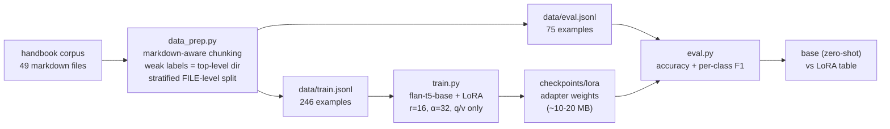

# handbook-qa-lora

LoRA fine-tuning of a small open model (`google/flan-t5-base`, 250M) for **topic classification over interview-handbook notes** — the "I've actually trained a model" project. Classification framed as generation: input `classify interview topic: <chunk>`, target `<label>`.

**Free tier everywhere:** the model is free and open on Hugging Face (no gated access, no license click-through), training runs on a **free Colab T4** (no Colab Pro), the dataset is built from her own public handbook notes, and there are no paid APIs, datasets, or tooling at any step. If any step below ever required payment, that would be a bug — file an issue.

> **Status: training is the one GPU step and has not run yet.** Everything else is built and validated on CPU: the full data pipeline, a smoke training run, and zero-shot base-model evaluation. To train: open `notebooks/train_on_colab.ipynb` on a free Colab T4 (~15–30 min), then run `eval.py --adapter checkpoints/lora`.

## Architecture



## Dataset

Built from [java-backend-interview-handbook](https://github.com/BhagyashriT/java-backend-interview-handbook) with the chunking strategy vendored from [rag-handbook-qa](https://github.com/BhagyashriT/rag-handbook-qa) (markdown-aware, 400-char windows, section breadcrumbs kept as metadata).

| | train | eval |
|---|---|---|
| examples | 246 | 75 |
| labels | 8: backend, behavioral, dsa, java, learnings, lld, prep, system-design |

Label curation (deterministic, seed 42): top-level directory = label (weak supervision — some chunks are cross-topic, stated as a limitation); `practice/` + `quick-revision/` merged into `prep`; root meta docs and `src/` dropped; chunks < 150 chars dropped. **The split is at file level, stratified by label** — no file appears in both splits, so overlapping windows can't leak from train into eval.

Class imbalance is real (system-design dominates; lld/behavioral are thin) — per-class F1 in `eval.py` exists precisely to show it.

## Model choice

`google/flan-t5-base` (250M params):
- **Why T5, not a decoder:** classification-as-generation is native to seq2seq; no classification head to bolt on, and the label vocabulary stays human-readable.
- **Why flan (instruction-tuned):** the zero-shot base is a *meaningful* baseline. "LoRA beats zero-shot by +X" is a much stronger story than "LoRA beats random."
- **Why base, not small/large:** small (80M) is the CPU smoke-test model; large (780M) trains just as easily on a T4 but adds notebook time for little narrative gain. Base is the sweet spot — and the code takes `--model` anyway.
- **Why LoRA r=16/α=32 on q,v:** the standard starting point from the LoRA paper; ~0.4% of params trainable (~1M). Full fine-tuning of 250M on 246 examples would be wasteful and overfit-prone.

## Train on Colab (the GPU step)

1. Open `notebooks/train_on_colab.ipynb` in Colab.
2. **Runtime → Change runtime type → T4 GPU.**
3. Run all cells: verifies GPU → installs pinned deps → clones this repo → trains (~15–30 min) → evaluates base vs adapter → downloads the adapter zip.
4. Back home: `python eval.py --eval data/eval.jsonl --model google/flan-t5-base --adapter checkpoints/lora --out results.json`

Hyperparameters are flags on `train.py` (`--epochs 5 --batch-size 8 --lr 3e-4` defaults); change them deliberately and re-run eval — that's the actual ML loop this project teaches.

## What was validated without a GPU (this machine)

- `data_prep.py` end-to-end on the real corpus → 321 labeled examples, committed under `data/`.
- `train.py --smoke`: flan-t5-small, 16 examples, 4 steps on CPU — the LoRA training loop runs, gradients flow, loss decreases.
- `eval.py` on the base model (zero-shot, CPU) over the eval split — real measured numbers below.
- CI runs data-prep + unit tests on every push. Training is excluded from CI by design (needs a GPU).

## Base-model results (measured)

Zero-shot baselines, greedy decoding, exact-match on the label string:

| model | accuracy | macro-F1 | notes |
|---|---|---|---|
| flan-t5-small (80M), CPU | 0.067 | 0.016 | measured 2026-10-20; predicts "dsa" for nearly everything — worse than the majority-class baseline (system-design, 13/75 = 0.173). The 80M model cannot do this task zero-shot. |
| flan-t5-base (250M), zero-shot | — | — | fill in: `python eval.py --eval data/eval.jsonl --model google/flan-t5-base` |
| flan-t5-base + LoRA (after Colab) | — | — | fill in: `python eval.py --eval data/eval.jsonl --model google/flan-t5-base --adapter checkpoints/lora` |

The small-model number is the honest floor: instruction tuning alone doesn't solve a closed-vocabulary classification task the model wasn't trained on. The LoRA run is what closes the gap — that delta is the entire point of the project.

## When fine-tuning beats RAG (and when it doesn't)

Notes for interviews, grounded in this project — not in hype:

- **Fine-tuning fits this task; RAG would not.** Topic classification over a *closed, stable* label set is a weights problem: the mapping from phrasing to label should live in the model. Retrieval can't classify — it can only fetch.
- **Fine-tune when:** the task is stable (labels/output format don't change weekly), you need low latency (no retrieval hop), or you need a small model to behave like a bigger one on a narrow task.
- **Use RAG when:** the knowledge changes fast (handbook edits shouldn't require retraining), the knowledge is long-tail (facts the model never saw), or you need citations (RAG returns sources; a classifier returns a label).
- **The honest middle:** this dataset is 246 training examples with weak, directory-derived labels. That's enough to *demonstrate the loop* — data → LoRA → measured delta — not enough to claim a production classifier. The value here is the loop, the eval discipline, and knowing which tool fits which problem.

## Trade-offs

- **Weak supervision over hand-labeling:** directory = label is noisy (a "prep" chunk can discuss Java), but hand-labeling 321 chunks doesn't change the lesson; the noise is disclosed and bounded by the file-level split.
- **flan-t5-base over a decoder LLM:** decoders dominate mindshare, but for a fixed-label classifier T5's generate-the-label framing is simpler, cheaper, and easier to evaluate exactly.
- **LoRA over full fine-tuning:** 1M trainable params vs 250M — faster, cheaper, less overfitting on 246 examples; full FT left as a documented experiment, not the default.
- **Committed dataset:** `data/` (284K) is checked in so the Colab notebook is one click and CI can validate the pipeline. If the handbook grows 10x, move to a release artifact.

## Limitations

- **The LoRA adapter has not been trained yet** — the Colab notebook is the remaining step. Any accuracy claim about the tuned model would be invented; the table above stays empty until measured.
- Small, imbalanced dataset (lld: 10 train / behavioral: 14 train) — expect weak per-class F1 there; that's signal, not a bug.
- Weak labels: directory-derived, some chunks are cross-topic.
- Generation-based classification needs exact label strings; a constrained decoder would be more robust (documented future work).
- Token counts are estimates; eval latency on CPU is slow (documented subset flag exists).

## Layout

```
data_prep.py          dataset builder (chunk → label → stratified file-level split)
train.py              LoRA fine-tune (HF Trainer + PEFT); --smoke for CPU validation
eval.py               accuracy + per-class F1; base vs --adapter comparison table
src/hqlora/chunking.py  markdown-aware chunking, vendored from rag-handbook-qa
data/                 train.jsonl / eval.jsonl / stats.json (committed)
notebooks/train_on_colab.ipynb   the one-click GPU training run
tests/                stdlib unittest: labels, split integrity, determinism
```

## License

MIT — see [LICENSE](LICENSE). Chunking module vendored from [rag-handbook-qa](https://github.com/BhagyashriT/rag-handbook-qa) (same author, MIT).
